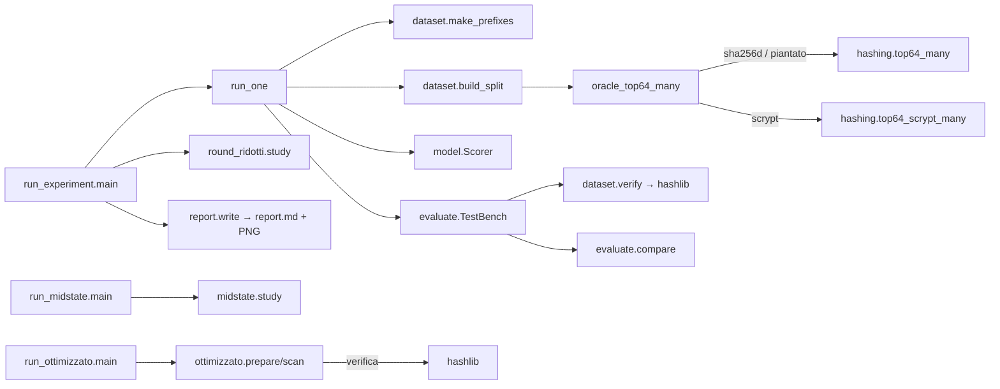

# sha256-ml-esperimento

Esperimento di ricerca, su dati di prova, per verificare se un modello di ML sceglie nonce che
danno un doppio SHA-256 sotto soglia più spesso del caso. NON è mining reale: nessuna
connessione a pool, nodi o wallet. Ipotesi da falsificare, non da far funzionare.

## Fatti non ovvi
- Sta fuori da iCloud di proposito (scelta di Angelo, 31/10/2026): dataset e venv grandi.
- venv: `.venv/` con Python 3.13 di Homebrew (il python3 di sistema è 3.9 e non ha sklearn).
- Il multiprocessing su macOS usa spawn: gli script che chiamano `top64_many` devono avere
  `if __name__ == "__main__"` e stare su file (da stdin crasha con BrokenProcessPool).
- A 64 round `hashing.top64` passa SEMPRE da hashlib; numpy serve solo ai round ridotti.
- Esplorazione del 31/10/2026: doppio SHA-256 non impara nemmeno a 4 round; SHA-256 singolo
  a 4 round ha AUC 1,0 sullo stesso prefisso, già 0,5 a 5 round. Per questo il controllo
  positivo è doppio: scala dei round + oracolo «piantato» (vantaggio finto ×2).
- Corsa completa del 31/10/2026 (2139 s, `risultati/`): controllo piantato trovato (lift ~×1,9,
  AUC al massimo teorico 0,528); SHA-256 doppio reale: nessun modello significativo a k=12
  (MDE +23%) né a k=16 (MDE +99%, poca potenza). La logistica è deterministica: i suoi 3 seed
  danno risultati identici, non sono ripetizioni.
- Oracolo `scrypt` (31/10/2026): Litecoin confronta il digest come intero LITTLE-endian, quindi
  top64 = digest[24:32] letto little-endian (non i primi 8 byte). ~260 µs/hash su un core,
  ~21k hash/s su 8 core: dimensioni proprie in `config.scrypt`. Corsa: nessun modello batte il
  caso (MDE +6%). Niente round ridotti né piantato per scrypt.
- Studio midstate (`midstate.py`): a 4 round SHA singolo la prima parola dell'hash è
  (D_a + W3) mod 2^32 con D_a precalcolabile (test lo verifica). Esito: gbm/mlp AUC ~0,99 a
  4 round con D, 0,5 senza D e da 5 round in su.
- `ottimizzato.py` usa il formato Bitcoin VERO (80 byte, nonce 4 byte, W3 = nonce con byte
  invertiti; confronto little-endian -> H7 del secondo hash), diverso dalla pipeline ML (nonce
  8 byte, confronto big-endian). H7 = IV7 + e dopo il round 60: uscita anticipata esatta per k<=32.
- Gli iperparametri dei modelli sono fissati a priori: cambiarli dopo aver visto il test è p-hacking.

## Comandi
- Test: `.venv/bin/python -m pytest -q`
- Prova rapida: `.venv/bin/python run_experiment.py --rapido --out risultati_rapido`
- Completo: `.venv/bin/python run_experiment.py` (k=12 e 16) → `risultati/report.md`
- Scrypt: `.venv/bin/python run_experiment.py --oracolo scrypt --out risultati_scrypt` (~100 min)
- Ottimizzato: `.venv/bin/python run_ottimizzato.py` → `risultati_ottimizzato/` (~1 min)
- Midstate: `.venv/bin/python run_midstate.py` → `risultati_midstate/` (~12 min)

## Mappa dei percorsi
`run_experiment.py::main` → per ogni corsa `run_one` → `dataset.make_prefixes` (split per
prefisso) → `dataset.build_split` → `dataset.oracle_top64_many` → `hashing.top64_many`
→ `model.Scorer.fit` → `evaluate.TestBench.run_model` (ordina, poi **ricalcola** i top-M con
`dataset.verify`) → `evaluate.compare` (binomiale, z-test, bootstrap) → `report.write` →
`risultati/report.md` + PNG. Studio dei round: `round_ridotti.study` (fuori dal flusso del
selettore, usa `hashing.top64_many` con `rounds<64`).

Punti di divergenza: `oracolo` = `sha256d` (reale), `scrypt` (reale, `hashing.top64_scrypt_many`,
salta round ridotti e piantato) o `piantato` (finto, controllo positivo);
`rounds == 64` → hashlib, altrimenti numpy.

