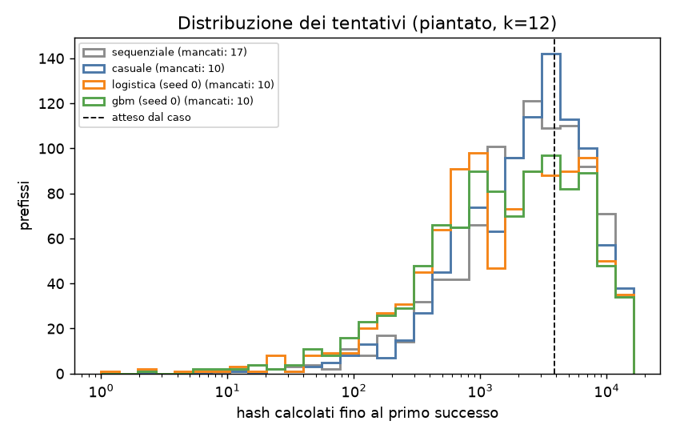
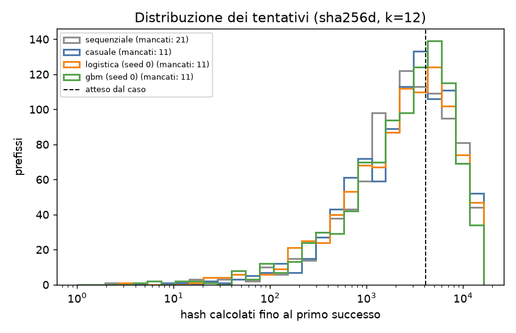
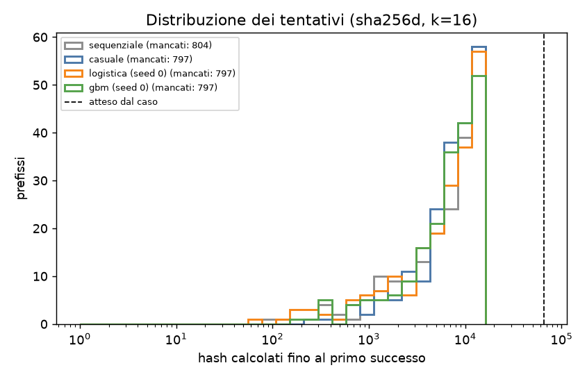
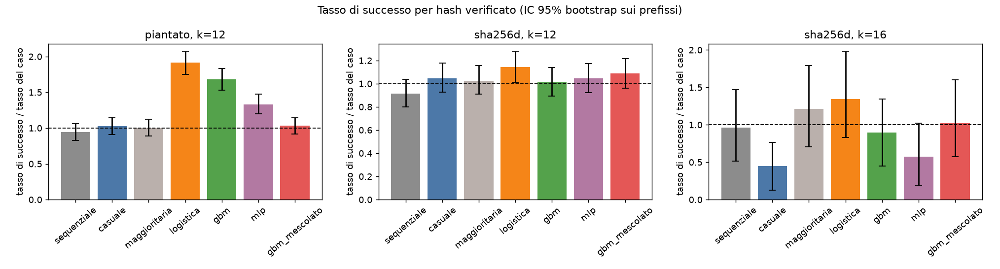
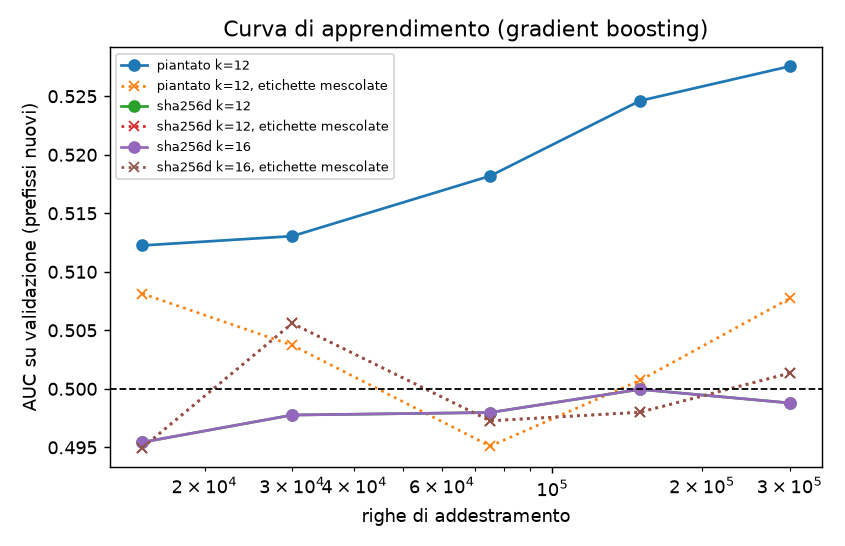
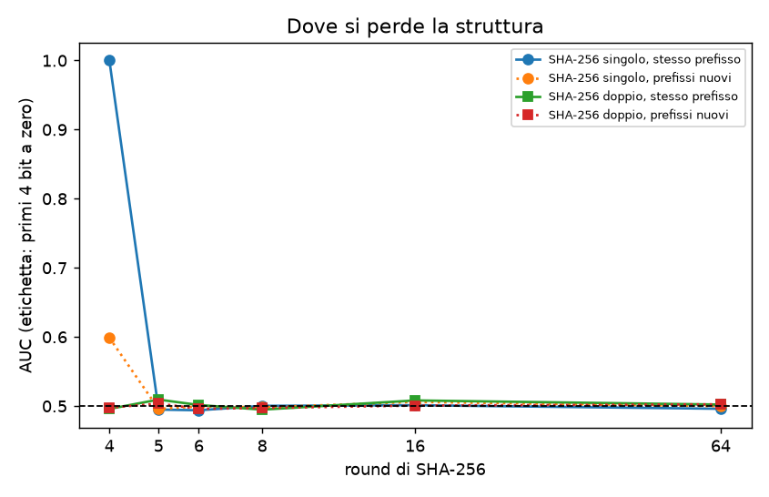

# Esperimento: un modello di ML sceglie nonce SHA-256 migliori del caso?

Comando: `.venv/bin/python run_experiment.py --k 12 16 --seed 20261031`  
Seed principale: `20261031` (tutti gli altri seed derivano da questo); seed dei modelli: [0, 1, 2]  
Ambiente: Python 3.13.16, numpy 2.5.4, scikit-learn 1.9.1, arm64 8 core. Durata: 2139 s.

## 1. Leakage e bias segnalati prima dei risultati

- **Split per prefisso.** Prefissi in comune fra train, validazione e test: 0. Il test usa solo prefissi mai visti in addestramento.
- **Verifica reale.** Ogni candidato scelto da un modello è stato ricalcolato a parte con `hashlib`; le incoerenze con gli hash del pool sono 0 (altrimenti la corsa si interrompe).
- **Feature.** Solo bit del nonce, statistiche elementari del nonce e bit della coda del prefisso: niente che derivi dall'hash.
- **Soglia di addestramento più facile.** I modelli imparano l'etichetta a k_train=6 (positivi 1 su 64), non a k: con k=12 i positivi sarebbero troppo pochi. È una scelta di progetto, non leakage: il successo si conta sempre alla soglia vera k.
- **Sottocampionamento dei negativi** in addestramento (al massimo 300,000 righe, tutti i positivi tenuti). Le probabilità non sono calibrate, ma serve solo l'ordinamento.
- **Pareggi.** A parità di punteggio l'ordine è casuale con seed: la classe maggioritaria equivale quindi alla ricerca casuale, come deve.
- **Iperparametri fissati prima** di guardare il test; nessuna ricerca sul test.
- **Confronti multipli.** Correzione di Bonferroni sul numero di modelli × seed di ogni corsa. Le corse a k diversi non sono corrette fra loro.
- **Bootstrap a grappolo** sui prefissi: gli hash dello stesso prefisso non sono osservazioni indipendenti rispetto al modello.
- **z-test.** Confronta il modello con la ricerca casuale nello stesso pool: i due campioni si sovrappongono un po', quindi il test principale è quello binomiale contro il tasso teorico 2^-k.
- **Oracolo «piantato».** È una funzione finta, costruita apposta con un vantaggio (×2 sui nonce con i 4 bit bassi a zero): non è SHA-256 e serve solo a provare la pipeline.
- **Formato.** Il nonce è di 8 byte little-endian come da specifica; in Bitcoin è di 4 byte, e il prefisso è casuale invece di un vero header.

## 2. Potenza statistica

| corsa | hash verificati per metodo | tasso del caso | miglioramento minimo rilevabile (potenza 80%) |
|---|---|---|---|
| piantato, k=12 | 1,024,000 | 0.000259 | +22% |
| sha256d, k=12 | 1,024,000 | 0.000244 | +23% |
| sha256d, k=16 | 1,024,000 | 1.53e-05 | +99% |

## 3. Esito in breve

- **piantato, k=12** (controllo positivo): il segnale piantato è stato imparato (9 modelli; migliore gbm (seed 1), AUC 0.529 su un massimo teorico di 0.528) e il selettore ottiene un tasso di successo significativamente sopra il caso.
- **sha256d, k=12**: **nessun modello batte il caso**: né il selettore né l'AUC sono significativi (Bonferroni su 15 confronti). Con questi dati un miglioramento superiore a circa il 23% sarebbe stato rilevato con l'80% di probabilità.
- **sha256d, k=16**: **nessun modello batte il caso**: né il selettore né l'AUC sono significativi (Bonferroni su 15 confronti). Con questi dati un miglioramento superiore a circa il 99% sarebbe stato rilevato con l'80% di probabilità.

## 4. Risultati per corsa

### piantato, k=12

Addestramento: 300,000 righe, 27,507 positivi a k_train. Test: 1000 prefissi nuovi × 16,384 candidati, verificati i primi 1,024. Un doppio hash costa 0.79 µs.

| metodo | successi / verificati | tasso × caso [IC 95%] | lift vs casuale [IC 95%] | p binomiale | p z-test | significativo | AUC test (k) | AUC test (k_train), p | AUC val (k_train) | richiamo (caso) | hash per successo | costo in hash eq. per successo |
|---|---|---|---|---|---|---|---|---|---|---|---|---|
| sequenziale | 250 / 1,024,000 | 0.941 [0.824, 1.062] | 0.916 [0.773, 1.088] | 0.84 | 0.84 | — | — | — | — | — | 4,096 | 4,096 |
| casuale (seed 0) | 273 / 1,024,000 | 1.028 [0.911, 1.148] | 1.000 [1.000, 1.000] | 0.33 | 0.5 | — | — | — | — | — | 3,751 | 3,751 |
| casuale (seed 1) | 243 / 1,024,000 | 0.915 [0.802, 1.032] | 1.000 [1.000, 1.000] | 0.92 | 0.5 | — | — | — | — | — | 4,214 | 4,214 |
| casuale (seed 2) | 254 / 1,024,000 | 0.956 [0.843, 1.073] | 1.000 [1.000, 1.000] | 0.77 | 0.5 | — | — | — | — | — | 4,031 | 4,031 |
| maggioritaria (seed 0) | 266 / 1,024,000 | 1.001 [0.892, 1.126] | 0.974 [0.823, 1.142] | 0.5 | 0.62 | no | 0.500 ± 0.004 | 0.5005 ± 0.0006, p=0.16 | 0.500 | 0.062 (0.062) | 3,850 | 3,968 |
| maggioritaria (seed 1) | 277 / 1,024,000 | 1.043 [0.930, 1.160] | 1.140 [0.964, 1.338] | 0.25 | 0.068 | no | 0.506 ± 0.004 | 0.4996 ± 0.0006, p=0.76 | 0.500 | 0.065 (0.062) | 3,697 | 3,799 |
| maggioritaria (seed 2) | 254 / 1,024,000 | 0.956 [0.843, 1.077] | 1.000 [0.842, 1.177] | 0.77 | 0.5 | no | 0.500 ± 0.004 | 0.5000 ± 0.0006, p=0.49 | 0.500 | 0.059 (0.062) | 4,031 | 4,146 |
| logistica (seed 0) | 508 / 1,024,000 | 1.912 [1.751, 2.074] | 1.861 [1.633, 2.126] | 5.8e-40 | 2e-17 | **SÌ** | 0.520 ± 0.004 | 0.5280 ± 0.0006, p=<1e-300 **impara** | 0.525 | 0.119 (0.062) | 2,016 | 9,002 |
| logistica (seed 1) | 508 / 1,024,000 | 1.912 [1.754, 2.097] | 2.091 [1.807, 2.422] | 5.8e-40 | 2e-22 | **SÌ** | 0.520 ± 0.004 | 0.5280 ± 0.0006, p=<1e-300 **impara** | 0.525 | 0.119 (0.062) | 2,016 | 8,798 |
| logistica (seed 2) | 508 / 1,024,000 | 1.912 [1.750, 2.086] | 2.000 [1.723, 2.332] | 5.8e-40 | 1.7e-20 | **SÌ** | 0.520 ± 0.004 | 0.5280 ± 0.0006, p=<1e-300 **impara** | 0.525 | 0.119 (0.062) | 2,016 | 10,677 |
| gbm (seed 0) | 446 / 1,024,000 | 1.679 [1.528, 1.833] | 1.634 [1.415, 1.887] | 4.1e-24 | 5.5e-11 | **SÌ** | 0.526 ± 0.004 | 0.5279 ± 0.0006, p=<1e-300 **impara** | 0.528 | 0.104 (0.062) | 2,296 | 203,345 |
| gbm (seed 1) | 453 / 1,024,000 | 1.705 [1.555, 1.849] | 1.864 [1.614, 2.157] | 1e-25 | 8.5e-16 | **SÌ** | 0.533 ± 0.005 | 0.5286 ± 0.0006, p=<1e-300 **impara** | 0.523 | 0.106 (0.062) | 2,260 | 219,535 |
| gbm (seed 2) | 464 / 1,024,000 | 1.747 [1.589, 1.916] | 1.827 [1.562, 2.117] | 2.4e-28 | 2.3e-15 | **SÌ** | 0.528 ± 0.004 | 0.5276 ± 0.0006, p=<1e-300 **impara** | 0.522 | 0.109 (0.062) | 2,207 | 204,362 |
| mlp (seed 0) | 354 / 1,024,000 | 1.333 [1.201, 1.472] | 1.297 [1.114, 1.498] | 1.4e-07 | 0.00061 | **SÌ** | 0.509 ± 0.004 | 0.5167 ± 0.0006, p=4.9e-192 **impara** | 0.516 | 0.083 (0.062) | 2,893 | 25,142 |
| mlp (seed 1) | 334 / 1,024,000 | 1.257 [1.126, 1.393] | 1.374 [1.165, 1.619] | 3e-05 | 7.6e-05 | **SÌ** | 0.521 ± 0.004 | 0.5201 ± 0.0006, p=9.5e-276 **impara** | 0.516 | 0.078 (0.062) | 3,066 | 26,332 |
| mlp (seed 2) | 335 / 1,024,000 | 1.261 [1.137, 1.400] | 1.319 [1.128, 1.554] | 2.3e-05 | 0.00042 | **SÌ** | 0.518 ± 0.004 | 0.5193 ± 0.0006, p=2.3e-255 **impara** | 0.513 | 0.078 (0.062) | 3,057 | 25,948 |
| gbm_mescolato (seed 0) | 274 / 1,024,000 | 1.032 [0.915, 1.144] | 1.004 [0.866, 1.185] | 0.31 | 0.48 | no | 0.502 ± 0.004 | 0.4996 ± 0.0006, p=0.74 | 0.502 | 0.064 (0.062) | 3,737 | 392,755 |
| gbm_mescolato (seed 1) | 266 / 1,024,000 | 1.001 [0.881, 1.114] | 1.095 [0.927, 1.292] | 0.5 | 0.15 | no | 0.500 ± 0.004 | 0.5003 ± 0.0006, p=0.32 | 0.500 | 0.062 (0.062) | 3,850 | 362,590 |
| gbm_mescolato (seed 2) | 292 / 1,024,000 | 1.099 [0.979, 1.231] | 1.150 [0.965, 1.348] | 0.058 | 0.052 | no | 0.510 ± 0.004 | 0.5014 ± 0.0006, p=0.0074 | 0.500 | 0.068 (0.062) | 3,507 | 325,672 |

### sha256d, k=12

Addestramento: 300,000 righe, 25,885 positivi a k_train. Test: 1000 prefissi nuovi × 16,384 candidati, verificati i primi 1,024. Un doppio hash costa 0.78 µs.

| metodo | successi / verificati | tasso × caso [IC 95%] | lift vs casuale [IC 95%] | p binomiale | p z-test | significativo | AUC test (k) | AUC test (k_train), p | AUC val (k_train) | richiamo (caso) | hash per successo | costo in hash eq. per successo |
|---|---|---|---|---|---|---|---|---|---|---|---|---|
| sequenziale | 229 / 1,024,000 | 0.916 [0.800, 1.036] | 0.874 [0.730, 1.041] | 0.91 | 0.93 | — | — | — | — | — | 4,472 | 4,472 |
| casuale (seed 0) | 262 / 1,024,000 | 1.048 [0.928, 1.176] | 1.000 [1.000, 1.000] | 0.23 | 0.5 | — | — | — | — | — | 3,908 | 3,908 |
| casuale (seed 1) | 225 / 1,024,000 | 0.900 [0.788, 1.016] | 1.000 [1.000, 1.000] | 0.95 | 0.5 | — | — | — | — | — | 4,551 | 4,551 |
| casuale (seed 2) | 238 / 1,024,000 | 0.952 [0.832, 1.068] | 1.000 [1.000, 1.000] | 0.78 | 0.5 | — | — | — | — | — | 4,303 | 4,303 |
| maggioritaria (seed 0) | 256 / 1,024,000 | 1.024 [0.908, 1.156] | 0.977 [0.823, 1.152] | 0.36 | 0.6 | no | 0.502 ± 0.005 | 0.5007 ± 0.0006, p=0.12 | 0.500 | 0.064 (0.062) | 4,000 | 4,113 |
| maggioritaria (seed 1) | 255 / 1,024,000 | 1.020 [0.904, 1.144] | 1.133 [0.950, 1.333] | 0.38 | 0.085 | no | 0.505 ± 0.005 | 0.4997 ± 0.0006, p=0.69 | 0.500 | 0.064 (0.062) | 4,016 | 4,126 |
| maggioritaria (seed 2) | 239 / 1,024,000 | 0.956 [0.836, 1.080] | 1.004 [0.837, 1.185] | 0.76 | 0.48 | no | 0.500 ± 0.005 | 0.4998 ± 0.0006, p=0.64 | 0.500 | 0.060 (0.062) | 4,285 | 4,404 |
| logistica (seed 0) | 286 / 1,024,000 | 1.144 [1.012, 1.280] | 1.092 [0.929, 1.292] | 0.014 | 0.15 | no | 0.494 ± 0.005 | 0.4996 ± 0.0006, p=0.77 | 0.502 | 0.071 (0.062) | 3,580 | 18,365 |
| logistica (seed 1) | 286 / 1,024,000 | 1.144 [1.016, 1.288] | 1.271 [1.083, 1.488] | 0.014 | 0.0035 | no | 0.494 ± 0.005 | 0.4996 ± 0.0006, p=0.77 | 0.502 | 0.071 (0.062) | 3,580 | 15,857 |
| logistica (seed 2) | 286 / 1,024,000 | 1.144 [1.012, 1.276] | 1.202 [1.027, 1.440] | 0.014 | 0.018 | no | 0.494 ± 0.005 | 0.4996 ± 0.0006, p=0.77 | 0.502 | 0.071 (0.062) | 3,580 | 15,685 |
| gbm (seed 0) | 254 / 1,024,000 | 1.016 [0.892, 1.140] | 0.969 [0.820, 1.158] | 0.41 | 0.64 | no | 0.498 ± 0.005 | 0.4994 ± 0.0006, p=0.83 | 0.498 | 0.063 (0.062) | 4,031 | 337,662 |
| gbm (seed 1) | 230 / 1,024,000 | 0.920 [0.800, 1.040] | 1.022 [0.860, 1.225] | 0.9 | 0.41 | no | 0.498 ± 0.005 | 0.4993 ± 0.0006, p=0.9 | 0.501 | 0.057 (0.062) | 4,452 | 378,153 |
| gbm (seed 2) | 237 / 1,024,000 | 0.948 [0.824, 1.072] | 0.996 [0.833, 1.190] | 0.8 | 0.52 | no | 0.497 ± 0.005 | 0.4995 ± 0.0006, p=0.82 | 0.495 | 0.059 (0.062) | 4,321 | 391,908 |
| mlp (seed 0) | 262 / 1,024,000 | 1.048 [0.924, 1.172] | 1.000 [0.855, 1.168] | 0.23 | 0.5 | no | 0.494 ± 0.005 | 0.4994 ± 0.0006, p=0.83 | 0.499 | 0.065 (0.062) | 3,908 | 32,770 |
| mlp (seed 1) | 214 / 1,024,000 | 0.856 [0.736, 0.960] | 0.951 [0.785, 1.145] | 0.99 | 0.7 | no | 0.501 ± 0.005 | 0.5001 ± 0.0006, p=0.44 | 0.500 | 0.053 (0.062) | 4,785 | 41,017 |
| mlp (seed 2) | 265 / 1,024,000 | 1.060 [0.944, 1.188] | 1.113 [0.941, 1.312] | 0.18 | 0.11 | no | 0.500 ± 0.005 | 0.4997 ± 0.0006, p=0.67 | 0.497 | 0.066 (0.062) | 3,864 | 32,557 |
| gbm_mescolato (seed 0) | 272 / 1,024,000 | 1.088 [0.960, 1.216] | 1.038 [0.888, 1.233] | 0.088 | 0.33 | no | 0.511 ± 0.005 | 0.4994 ± 0.0006, p=0.85 | 0.496 | 0.068 (0.062) | 3,765 | 314,668 |
| gbm_mescolato (seed 1) | 228 / 1,024,000 | 0.912 [0.792, 1.040] | 1.013 [0.840, 1.231] | 0.92 | 0.44 | no | 0.497 ± 0.005 | 0.4993 ± 0.0006, p=0.87 | 0.504 | 0.057 (0.062) | 4,491 | 340,511 |
| gbm_mescolato (seed 2) | 244 / 1,024,000 | 0.976 [0.852, 1.100] | 1.025 [0.854, 1.220] | 0.66 | 0.39 | no | 0.500 ± 0.005 | 0.5001 ± 0.0006, p=0.42 | 0.497 | 0.061 (0.062) | 4,197 | 298,050 |

### sha256d, k=16

Addestramento: 300,000 righe, 25,885 positivi a k_train. Test: 1000 prefissi nuovi × 16,384 candidati, verificati i primi 1,024. Un doppio hash costa 0.78 µs.

| metodo | successi / verificati | tasso × caso [IC 95%] | lift vs casuale [IC 95%] | p binomiale | p z-test | significativo | AUC test (k) | AUC test (k_train), p | AUC val (k_train) | richiamo (caso) | hash per successo | costo in hash eq. per successo |
|---|---|---|---|---|---|---|---|---|---|---|---|---|
| sequenziale | 15 / 1,024,000 | 0.960 [0.512, 1.472] | 2.143 [1.000, 6.000] | 0.6 | 0.044 | — | — | — | — | — | 68,267 | 68,267 |
| casuale (seed 0) | 7 / 1,024,000 | 0.448 [0.128, 0.768] | 1.000 [1.000, 1.000] | 0.99 | 0.5 | — | — | — | — | — | 146,286 | 146,286 |
| casuale (seed 1) | 12 / 1,024,000 | 0.768 [0.384, 1.216] | 1.000 [1.000, 1.000] | 0.85 | 0.5 | — | — | — | — | — | 85,333 | 85,333 |
| casuale (seed 2) | 15 / 1,024,000 | 0.960 [0.512, 1.408] | 1.000 [1.000, 1.000] | 0.6 | 0.5 | — | — | — | — | — | 68,267 | 68,267 |
| maggioritaria (seed 0) | 19 / 1,024,000 | 1.216 [0.704, 1.792] | 2.714 [1.273, 8.500] | 0.23 | 0.0093 | no | 0.488 ± 0.019 | 0.5007 ± 0.0006, p=0.12 | 0.500 | 0.085 (0.062) | 53,895 | 56,302 |
| maggioritaria (seed 1) | 13 / 1,024,000 | 0.832 [0.384, 1.280] | 1.083 [0.500, 2.600] | 0.78 | 0.42 | no | 0.502 ± 0.019 | 0.4997 ± 0.0006, p=0.69 | 0.500 | 0.058 (0.062) | 78,769 | 81,206 |
| maggioritaria (seed 2) | 10 / 1,024,000 | 0.640 [0.256, 1.088] | 0.667 [0.250, 1.556] | 0.95 | 0.84 | no | 0.489 ± 0.019 | 0.4998 ± 0.0006, p=0.64 | 0.500 | 0.045 (0.062) | 102,400 | 105,357 |
| logistica (seed 0) | 21 / 1,024,000 | 1.344 [0.832, 1.984] | 3.000 [1.400, 8.667] | 0.11 | 0.0041 | no | 0.514 ± 0.019 | 0.4996 ± 0.0006, p=0.77 | 0.502 | 0.094 (0.062) | 48,762 | 217,407 |
| logistica (seed 1) | 21 / 1,024,000 | 1.344 [0.832, 1.920] | 1.750 [0.857, 3.668] | 0.11 | 0.059 | no | 0.514 ± 0.019 | 0.4996 ± 0.0006, p=0.77 | 0.502 | 0.094 (0.062) | 48,762 | 210,878 |
| logistica (seed 2) | 21 / 1,024,000 | 1.344 [0.832, 1.920] | 1.400 [0.773, 2.750] | 0.11 | 0.16 | no | 0.514 ± 0.019 | 0.4996 ± 0.0006, p=0.77 | 0.502 | 0.094 (0.062) | 48,762 | 245,227 |
| gbm (seed 0) | 14 / 1,024,000 | 0.896 [0.448, 1.344] | 2.000 [0.833, 6.000] | 0.69 | 0.063 | no | 0.501 ± 0.019 | 0.4994 ± 0.0006, p=0.83 | 0.498 | 0.062 (0.062) | 73,143 | 5,655,087 |
| gbm (seed 1) | 8 / 1,024,000 | 0.512 [0.192, 0.896] | 0.667 [0.214, 1.667] | 0.99 | 0.81 | no | 0.510 ± 0.019 | 0.4993 ± 0.0006, p=0.9 | 0.501 | 0.036 (0.062) | 128,000 | 10,820,377 |
| gbm (seed 2) | 12 / 1,024,000 | 0.768 [0.384, 1.216] | 0.800 [0.353, 1.667] | 0.85 | 0.72 | no | 0.486 ± 0.019 | 0.4995 ± 0.0006, p=0.82 | 0.495 | 0.054 (0.062) | 85,333 | 6,953,408 |
| mlp (seed 0) | 9 / 1,024,000 | 0.576 [0.192, 1.024] | 1.286 [0.400, 4.000] | 0.97 | 0.31 | no | 0.457 ± 0.019 | 0.4994 ± 0.0006, p=0.83 | 0.499 | 0.040 (0.062) | 113,778 | 972,684 |
| mlp (seed 1) | 15 / 1,024,000 | 0.960 [0.512, 1.472] | 1.250 [0.583, 3.000] | 0.6 | 0.28 | no | 0.521 ± 0.020 | 0.5001 ± 0.0006, p=0.44 | 0.500 | 0.067 (0.062) | 68,267 | 572,980 |
| mlp (seed 2) | 16 / 1,024,000 | 1.024 [0.576, 1.536] | 1.067 [0.526, 2.182] | 0.5 | 0.43 | no | 0.484 ± 0.019 | 0.4997 ± 0.0006, p=0.67 | 0.497 | 0.071 (0.062) | 64,000 | 532,061 |
| gbm_mescolato (seed 0) | 16 / 1,024,000 | 1.024 [0.576, 1.600] | 2.286 [1.071, 6.667] | 0.5 | 0.03 | no | 0.504 ± 0.019 | 0.4994 ± 0.0006, p=0.85 | 0.496 | 0.071 (0.062) | 64,000 | 5,794,432 |
| gbm_mescolato (seed 1) | 13 / 1,024,000 | 0.832 [0.448, 1.280] | 1.083 [0.450, 2.500] | 0.78 | 0.42 | no | 0.497 ± 0.019 | 0.4993 ± 0.0006, p=0.87 | 0.504 | 0.058 (0.062) | 78,769 | 5,957,993 |
| gbm_mescolato (seed 2) | 13 / 1,024,000 | 0.832 [0.448, 1.280] | 0.867 [0.400, 1.750] | 0.78 | 0.65 | no | 0.476 ± 0.019 | 0.5001 ± 0.0006, p=0.42 | 0.497 | 0.058 (0.062) | 78,769 | 6,591,421 |

## 5. Confronto dei tassi di successo

## 6. Curva di apprendimento

## 7. Round ridotti: dove si perde la struttura

| funzione | round | AUC stesso prefisso (min–max) | AUC prefissi nuovi |
|---|---|---|---|
| singolo | 4 | 1.000 (1.000–1.000) | 0.599 |
| singolo | 5 | 0.495 (0.493–0.497) | 0.496 |
| singolo | 6 | 0.494 (0.477–0.508) | 0.500 |
| singolo | 8 | 0.500 (0.498–0.502) | 0.498 |
| singolo | 16 | 0.501 (0.498–0.504) | 0.506 |
| singolo | 64 | 0.496 (0.489–0.510) | 0.500 |
| doppio | 4 | 0.496 (0.489–0.504) | 0.498 |
| doppio | 5 | 0.509 (0.506–0.516) | 0.504 |
| doppio | 6 | 0.502 (0.493–0.508) | 0.496 |
| doppio | 8 | 0.495 (0.492–0.500) | 0.497 |
| doppio | 16 | 0.508 (0.501–0.522) | 0.501 |
| doppio | 64 | 0.502 (0.499–0.504) | 0.503 |

Lettura: «stesso prefisso» misura se esiste struttura in assoluto (leakage voluto). Un'AUC su prefissi nuovi lontana da 0,5 al round 4 del singolo (sopra o sotto, a seconda del seed) non è un segnale che generalizza: con pochi prefissi di addestramento il modello impara la finestra di valori buoni di quei prefissi, che sui prefissi nuovi cade altrove per caso. Con la prova rapida (2 prefissi) era 0,23, con la completa (3 prefissi) 0,60.

## 8. Come leggere le colonne

- **tasso × caso**: 1,0 vuol dire uguale al caso; 2,0 vuol dire il doppio dei successi.
- **lift vs casuale**: stesso confronto, ma con la ricerca casuale fatta davvero sugli stessi candidati.
- **p**: probabilità di vedere un vantaggio almeno così grande se il modello non servisse a niente. «Significativo» richiede entrambi i p sotto α/numero di confronti.
- **AUC**: 0,5 = il modello ordina a caso; 1,0 = ordina perfettamente.
- **richiamo (caso)**: quota dei successi del pool finiti fra i candidati scelti; fra parentesi il valore atteso scegliendo a caso.
- **costo in hash eq.**: hash verificati più tempo di inferenza (su tutti gli N candidati) e di addestramento, convertiti in hash equivalenti, diviso i successi. Va confrontato con «hash per successo» della ricerca casuale.
