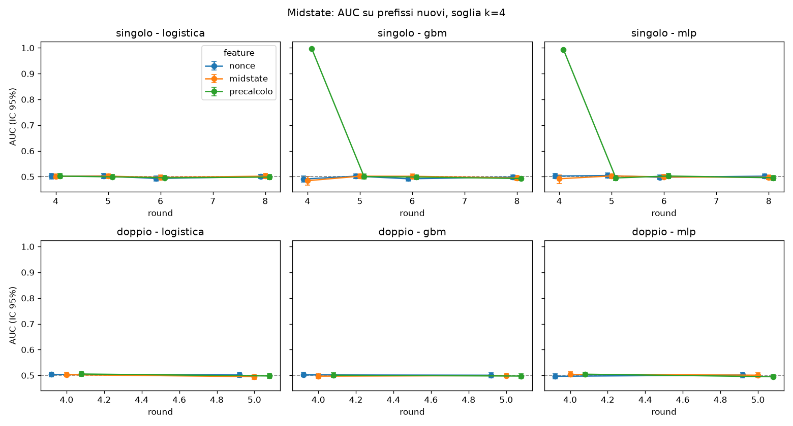

# Studio midstate: fra 4 e 5 round

Corsa del 31/10/2026, 11.5 minuti. Parametri: {'n_train': 3000, 'n_test': 1000, 'per_prefix': 64, 'reps': 500, 'motivo': ''}.

## Ipotesi pre-registrate (copiate da `midstate.py`)

```
Ipotesi pre-registrate (scritte il 31/10/2026, prima di guardare i risultati):
  H1  SHA singolo a 4 round con feature "precalcolo": AUC su prefissi nuovi nettamente > 0,5.
  H2  SHA singolo a 4 round con sole feature del nonce: AUC ~ 0,5 (manca D; vedi round_ridotti).
  H3  da 5 round in su, e per il doppio SHA a ogni R: AUC ~ 0,5 con qualunque feature.
Iperparametri fissi; test unilaterale AUC > 0,5 con errore standard da bootstrap a grappolo
sui prefissi; Bonferroni su tutte le celle (round x funzione x feature x modello).
```

## Verdetti

- **H1: confermata.** migliore: gbm AUC 0.998, p Bonferroni 0 (criterio: p_bonf < 0,05 e AUC >= 0.55)
- **H2: confermata.** massima AUC 0.503 (mlp), p Bonferroni 1 (criterio: nessuna cella significativa e AUC <= 0.52)
- **H3: confermata.** 45 celle, massima AUC 0.505 (doppio R=4 precalcolo logistica), celle significative: 0 (criterio: nessuna significativa e AUC <= 0.52)

I criteri numerici (AUC >= 0,55 per H1, <= 0,52 per il "~0,5" di H2 e H3) sono l'operativizzazione di «nettamente» e «~», fissata nello script prima di vedere i numeri.

## Tabella completa

p unilaterale AUC > 0,5 da z = (AUC - 0,5) / se_bootstrap; Bonferroni su 54 celle.

| funzione | round | feature | modello | AUC | IC 95% | se | z | p | p Bonf. | lift top 1/16 |
|---|---|---|---|---|---|---|---|---|---|---|
| singolo | 4 | nonce | logistica | 0.5021 | 0.490-0.512 | 0.0058 | 0.36 | 0.361 | 1 | 1.11 |
| singolo | 4 | nonce | gbm | 0.4910 | 0.479-0.503 | 0.0062 | -1.45 | 0.926 | 1 | 0.98 |
| singolo | 4 | nonce | mlp | 0.5027 | 0.492-0.513 | 0.0050 | 0.55 | 0.292 | 1 | 1.02 |
| singolo | 4 | midstate | logistica | 0.5017 | 0.494-0.510 | 0.0047 | 0.36 | 0.359 | 1 | 1.11 |
| singolo | 4 | midstate | gbm | 0.4845 | 0.468-0.500 | 0.0084 | -1.85 | 0.968 | 1 | 0.95 |
| singolo | 4 | midstate | mlp | 0.4921 | 0.474-0.507 | 0.0088 | -0.90 | 0.817 | 1 | 0.96 |
| singolo | 4 | precalcolo | logistica | 0.5025 | 0.493-0.512 | 0.0048 | 0.52 | 0.303 | 1 | 1.12 |
| singolo | 4 | precalcolo | gbm | 0.9977 | 0.997-0.998 | 0.0001 | 3401.57 | 0 | 0 | 12.66 |
| singolo | 4 | precalcolo | mlp | 0.9936 | 0.993-0.994 | 0.0004 | 1169.98 | 0 | 0 | 12.06 |
| singolo | 5 | nonce | logistica | 0.5029 | 0.493-0.512 | 0.0048 | 0.59 | 0.277 | 1 | 1.03 |
| singolo | 5 | nonce | gbm | 0.5021 | 0.494-0.511 | 0.0045 | 0.47 | 0.318 | 1 | 0.93 |
| singolo | 5 | nonce | mlp | 0.5045 | 0.496-0.514 | 0.0050 | 0.91 | 0.18 | 1 | 1.03 |
| singolo | 5 | midstate | logistica | 0.5021 | 0.493-0.510 | 0.0045 | 0.47 | 0.319 | 1 | 1.04 |
| singolo | 5 | midstate | gbm | 0.5020 | 0.492-0.511 | 0.0047 | 0.43 | 0.333 | 1 | 1.00 |
| singolo | 5 | midstate | mlp | 0.5030 | 0.494-0.512 | 0.0048 | 0.64 | 0.262 | 1 | 1.06 |
| singolo | 5 | precalcolo | logistica | 0.4994 | 0.491-0.508 | 0.0046 | -0.13 | 0.552 | 1 | 1.04 |
| singolo | 5 | precalcolo | gbm | 0.5005 | 0.491-0.510 | 0.0047 | 0.11 | 0.458 | 1 | 1.01 |
| singolo | 5 | precalcolo | mlp | 0.4953 | 0.486-0.504 | 0.0047 | -1.01 | 0.843 | 1 | 1.03 |
| singolo | 6 | nonce | logistica | 0.4931 | 0.484-0.502 | 0.0048 | -1.46 | 0.927 | 1 | 0.93 |
| singolo | 6 | nonce | gbm | 0.4920 | 0.483-0.501 | 0.0045 | -1.76 | 0.961 | 1 | 0.96 |
| singolo | 6 | nonce | mlp | 0.4977 | 0.489-0.506 | 0.0045 | -0.52 | 0.698 | 1 | 1.03 |
| singolo | 6 | midstate | logistica | 0.4972 | 0.488-0.506 | 0.0049 | -0.57 | 0.715 | 1 | 0.95 |
| singolo | 6 | midstate | gbm | 0.5017 | 0.492-0.510 | 0.0047 | 0.36 | 0.359 | 1 | 0.93 |
| singolo | 6 | midstate | mlp | 0.4993 | 0.490-0.508 | 0.0046 | -0.15 | 0.559 | 1 | 0.99 |
| singolo | 6 | precalcolo | logistica | 0.4958 | 0.487-0.505 | 0.0049 | -0.85 | 0.801 | 1 | 0.96 |
| singolo | 6 | precalcolo | gbm | 0.4988 | 0.489-0.508 | 0.0046 | -0.27 | 0.605 | 1 | 0.90 |
| singolo | 6 | precalcolo | mlp | 0.5026 | 0.493-0.512 | 0.0050 | 0.53 | 0.299 | 1 | 0.96 |
| singolo | 8 | nonce | logistica | 0.5004 | 0.492-0.510 | 0.0044 | 0.08 | 0.466 | 1 | 1.04 |
| singolo | 8 | nonce | gbm | 0.4983 | 0.489-0.507 | 0.0048 | -0.36 | 0.642 | 1 | 1.01 |
| singolo | 8 | nonce | mlp | 0.5021 | 0.493-0.510 | 0.0044 | 0.48 | 0.315 | 1 | 0.94 |
| singolo | 8 | midstate | logistica | 0.5021 | 0.493-0.512 | 0.0049 | 0.43 | 0.333 | 1 | 1.04 |
| singolo | 8 | midstate | gbm | 0.4948 | 0.486-0.504 | 0.0046 | -1.13 | 0.87 | 1 | 1.00 |
| singolo | 8 | midstate | mlp | 0.4977 | 0.489-0.507 | 0.0046 | -0.50 | 0.692 | 1 | 0.93 |
| singolo | 8 | precalcolo | logistica | 0.4986 | 0.489-0.508 | 0.0050 | -0.28 | 0.609 | 1 | 1.03 |
| singolo | 8 | precalcolo | gbm | 0.4930 | 0.484-0.502 | 0.0046 | -1.50 | 0.933 | 1 | 1.04 |
| singolo | 8 | precalcolo | mlp | 0.4959 | 0.486-0.505 | 0.0049 | -0.83 | 0.796 | 1 | 0.98 |
| doppio | 4 | nonce | logistica | 0.5037 | 0.494-0.513 | 0.0047 | 0.80 | 0.212 | 1 | 1.00 |
| doppio | 4 | nonce | gbm | 0.5020 | 0.494-0.511 | 0.0045 | 0.45 | 0.328 | 1 | 0.99 |
| doppio | 4 | nonce | mlp | 0.4966 | 0.487-0.505 | 0.0046 | -0.73 | 0.767 | 1 | 0.91 |
| doppio | 4 | midstate | logistica | 0.5027 | 0.495-0.512 | 0.0046 | 0.59 | 0.278 | 1 | 1.00 |
| doppio | 4 | midstate | gbm | 0.4971 | 0.488-0.507 | 0.0046 | -0.62 | 0.732 | 1 | 0.91 |
| doppio | 4 | midstate | mlp | 0.5039 | 0.495-0.513 | 0.0047 | 0.83 | 0.204 | 1 | 0.98 |
| doppio | 4 | precalcolo | logistica | 0.5055 | 0.497-0.515 | 0.0045 | 1.23 | 0.11 | 1 | 1.00 |
| doppio | 4 | precalcolo | gbm | 0.5007 | 0.492-0.510 | 0.0046 | 0.16 | 0.438 | 1 | 1.04 |
| doppio | 4 | precalcolo | mlp | 0.5047 | 0.496-0.513 | 0.0044 | 1.07 | 0.143 | 1 | 1.01 |
| doppio | 5 | nonce | logistica | 0.5017 | 0.492-0.511 | 0.0047 | 0.37 | 0.357 | 1 | 1.05 |
| doppio | 5 | nonce | gbm | 0.5008 | 0.491-0.510 | 0.0049 | 0.16 | 0.435 | 1 | 0.91 |
| doppio | 5 | nonce | mlp | 0.5015 | 0.491-0.511 | 0.0046 | 0.32 | 0.373 | 1 | 1.08 |
| doppio | 5 | midstate | logistica | 0.4953 | 0.486-0.503 | 0.0044 | -1.08 | 0.86 | 1 | 1.09 |
| doppio | 5 | midstate | gbm | 0.4993 | 0.490-0.508 | 0.0045 | -0.15 | 0.56 | 1 | 0.93 |
| doppio | 5 | midstate | mlp | 0.5009 | 0.492-0.510 | 0.0046 | 0.20 | 0.42 | 1 | 0.93 |
| doppio | 5 | precalcolo | logistica | 0.4979 | 0.488-0.507 | 0.0045 | -0.47 | 0.682 | 1 | 1.08 |
| doppio | 5 | precalcolo | gbm | 0.4975 | 0.489-0.507 | 0.0048 | -0.52 | 0.699 | 1 | 1.04 |
| doppio | 5 | precalcolo | mlp | 0.4949 | 0.487-0.504 | 0.0046 | -1.12 | 0.869 | 1 | 0.95 |



## Note

- **Costo.** A 4 round, dopo il precalcolo, l'hash è una somma a 32 bit (`H0 = D_a + W3`, verificata nei test). Qualunque modello costa più di calcolarlo: anche un modello che la imparasse non darebbe alcun vantaggio pratico. Il modello inoltre non calcola mai l'hash: riceve solo quantità indipendenti dal nonce.
- **Metodo.** Le AUC sono a k=4 (soglia facile, successo con p=1/16) per avere molti positivi; non sono la soglia dell'esperimento principale. Regime: prefissi nuovi (train e test non condividono prefissi), IC e se da bootstrap a grappolo sui prefissi. Iperparametri fissi, non toccati dopo aver visto il test.
