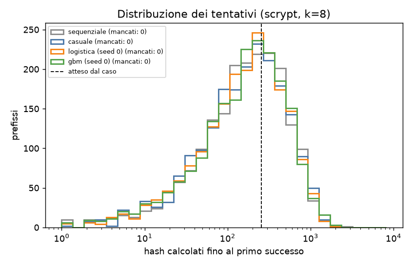
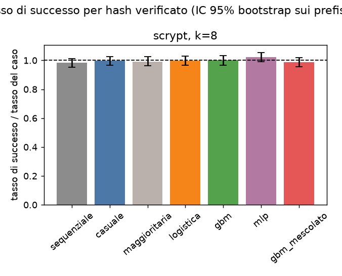
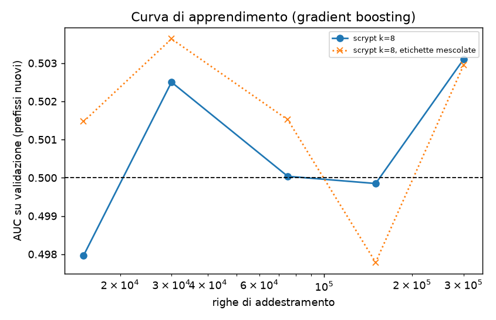

# Esperimento: un modello di ML sceglie nonce scrypt (Litecoin/Dogecoin) migliori del caso?

Comando: `.venv/bin/python run_experiment.py --oracolo scrypt --k 8 --seed 20261031`  
Seed principale: `20261031` (tutti gli altri seed derivano da questo); seed dei modelli: (0, 1, 2)  
Ambiente: Python 3.13.16, numpy 2.5.4, scikit-learn 1.9.1, arm64 8 core. Durata: 6243 s.

## 1. Leakage e bias segnalati prima dei risultati

- **Split per prefisso.** Prefissi in comune fra train, validazione e test: 0. Il test usa solo prefissi mai visti in addestramento.
- **Verifica reale.** Ogni candidato scelto da un modello è stato ricalcolato a parte con `hashlib`; le incoerenze con gli hash del pool sono 0 (altrimenti la corsa si interrompe).
- **Feature.** Solo bit del nonce, statistiche elementari del nonce e bit della coda del prefisso: niente che derivi dall'hash.
- **Soglia di addestramento più facile.** I modelli imparano l'etichetta a k_train=4 (positivi 1 su 16), non a k: con k=12 i positivi sarebbero troppo pochi. È una scelta di progetto, non leakage: il successo si conta sempre alla soglia vera k.
- **Sottocampionamento dei negativi** in addestramento (al massimo 300,000 righe, tutti i positivi tenuti). Le probabilità non sono calibrate, ma serve solo l'ordinamento.
- **Pareggi.** A parità di punteggio l'ordine è casuale con seed: la classe maggioritaria equivale quindi alla ricerca casuale, come deve.
- **Iperparametri fissati prima** di guardare il test; nessuna ricerca sul test.
- **Confronti multipli.** Correzione di Bonferroni sul numero di modelli × seed di ogni corsa. Le corse a k diversi non sono corrette fra loro.
- **Bootstrap a grappolo** sui prefissi: gli hash dello stesso prefisso non sono osservazioni indipendenti rispetto al modello.
- **z-test.** Confronta il modello con la ricerca casuale nello stesso pool: i due campioni si sovrappongono un po', quindi il test principale è quello binomiale contro il tasso teorico 2^-k.
- **Oracolo «piantato».** È una funzione finta, costruita apposta con un vantaggio (×2 sui nonce con i 4 bit bassi a zero): non è SHA-256 e serve solo a provare la pipeline.
- **Formato.** Il nonce è di 8 byte little-endian come da specifica; in Bitcoin è di 4 byte, e il prefisso è casuale invece di un vero header.
- **Formato scrypt.** `hashlib.scrypt(msg, salt=msg, n=1024, r=1, p=1, dklen=32)` con msg = prefisso di 76 byte + nonce di 8 byte little-endian (stesso messaggio della pipeline SHA-256). L'header Litecoin vero è di 80 byte con nonce a 4 byte. Il digest si confronta col target come intero little-endian: top64 = digest[24:32] letto little-endian, successo se top64 < 2^(64-k).
- **Controllo positivo non ripetuto.** L'oracolo «piantato» e il suo vantaggio finto (×2) sono già stati recuperati nella corsa SHA-256 (`risultati/`): la pipeline di valutazione è la stessa. Qui resta il controllo con etichette mescolate (`gbm_mescolato`) e la classe maggioritaria.
- **Round ridotti: non applicabile.** Lo studio dei round indeboliti riguarda solo la struttura di SHA-256; scrypt non è stato indebolito e lo studio è saltato.
- **Dimensioni fissate prima del test.** Scelte dopo aver misurato la velocità (circa 260 µs/hash su un core, ~430 volte il doppio SHA-256) e mai ritoccate dopo.
- **Tempi.** Un altro processo ha usato la CPU in parallelo: i tempi (inclusi gli «hash equivalenti» per l'inferenza e l'addestramento) possono essere gonfiati.

## 2. Potenza statistica

| corsa | hash verificati per metodo | tasso del caso | miglioramento minimo rilevabile (potenza 80%) |
|---|---|---|---|
| scrypt, k=8 | 1,024,000 | 0.00391 | +6% |

## 3. Esito in breve

- **scrypt, k=8**: **nessun modello batte il caso**: né il selettore né l'AUC sono significativi (Bonferroni su 15 confronti). Con questi dati un miglioramento superiore a circa il 6% sarebbe stato rilevato con l'80% di probabilità.

## 4. Risultati per corsa

### scrypt, k=8

Addestramento: 300,000 righe, 63,773 positivi a k_train. Test: 2000 prefissi nuovi × 8,192 candidati, verificati i primi 512. Un hash (scrypt) costa 260.45 µs.

| metodo | successi / verificati | tasso × caso [IC 95%] | lift vs casuale [IC 95%] | p binomiale | p z-test | significativo | AUC test (k) | AUC test (k_train), p | AUC val (k_train) | richiamo (caso) | hash per successo | costo in hash eq. per successo |
|---|---|---|---|---|---|---|---|---|---|---|---|---|
| sequenziale | 3932 / 1,024,000 | 0.983 [0.952, 1.013] | 0.987 [0.943, 1.029] | 0.86 | 0.72 | — | — | — | — | — | 260 | 260 |
| casuale (seed 0) | 3985 / 1,024,000 | 0.996 [0.965, 1.026] | 1.000 [1.000, 1.000] | 0.6 | 0.5 | — | — | — | — | — | 257 | 257 |
| casuale (seed 1) | 4034 / 1,024,000 | 1.008 [0.978, 1.039] | 1.000 [1.000, 1.000] | 0.3 | 0.5 | — | — | — | — | — | 254 | 254 |
| casuale (seed 2) | 4048 / 1,024,000 | 1.012 [0.981, 1.045] | 1.000 [1.000, 1.000] | 0.23 | 0.5 | — | — | — | — | — | 253 | 253 |
| maggioritaria (seed 0) | 3970 / 1,024,000 | 0.993 [0.962, 1.024] | 0.996 [0.954, 1.040] | 0.68 | 0.57 | no | 0.500 ± 0.001 | 0.5001 ± 0.0003, p=0.31 | 0.500 | 0.062 (0.062) | 258 | 258 |
| maggioritaria (seed 1) | 3955 / 1,024,000 | 0.989 [0.958, 1.019] | 0.980 [0.938, 1.023] | 0.76 | 0.81 | no | 0.500 ± 0.001 | 0.5002 ± 0.0003, p=0.24 | 0.500 | 0.062 (0.062) | 259 | 259 |
| maggioritaria (seed 2) | 4069 / 1,024,000 | 1.017 [0.987, 1.049] | 1.005 [0.964, 1.050] | 0.14 | 0.41 | no | 0.500 ± 0.001 | 0.4997 ± 0.0003, p=0.82 | 0.500 | 0.063 (0.062) | 252 | 252 |
| logistica (seed 0) | 3993 / 1,024,000 | 0.998 [0.968, 1.029] | 1.002 [0.962, 1.046] | 0.55 | 0.46 | no | 0.502 ± 0.001 | 0.5000 ± 0.0003, p=0.45 | 0.505 | 0.062 (0.062) | 256 | 260 |
| logistica (seed 1) | 3993 / 1,024,000 | 0.998 [0.966, 1.028] | 0.990 [0.950, 1.032] | 0.55 | 0.68 | no | 0.502 ± 0.001 | 0.5000 ± 0.0003, p=0.45 | 0.505 | 0.062 (0.062) | 256 | 259 |
| logistica (seed 2) | 3993 / 1,024,000 | 0.998 [0.968, 1.028] | 0.986 [0.944, 1.029] | 0.55 | 0.73 | no | 0.502 ± 0.001 | 0.5000 ± 0.0003, p=0.45 | 0.505 | 0.062 (0.062) | 256 | 259 |
| gbm (seed 0) | 4000 / 1,024,000 | 1.000 [0.968, 1.032] | 1.004 [0.960, 1.050] | 0.5 | 0.43 | no | 0.500 ± 0.001 | 0.5001 ± 0.0003, p=0.35 | 0.501 | 0.062 (0.062) | 256 | 311 |
| gbm (seed 1) | 4070 / 1,024,000 | 1.018 [0.988, 1.047] | 1.009 [0.965, 1.054] | 0.14 | 0.34 | no | 0.501 ± 0.001 | 0.5004 ± 0.0003, p=0.093 | 0.502 | 0.063 (0.062) | 252 | 306 |
| gbm (seed 2) | 3995 / 1,024,000 | 0.999 [0.966, 1.029] | 0.987 [0.946, 1.029] | 0.53 | 0.72 | no | 0.498 ± 0.001 | 0.4997 ± 0.0003, p=0.82 | 0.502 | 0.062 (0.062) | 256 | 316 |
| mlp (seed 0) | 4094 / 1,024,000 | 1.024 [0.992, 1.054] | 1.027 [0.981, 1.069] | 0.07 | 0.11 | no | 0.502 ± 0.001 | 0.4998 ± 0.0003, p=0.8 | 0.496 | 0.064 (0.062) | 250 | 256 |
| mlp (seed 1) | 4041 / 1,024,000 | 1.010 [0.980, 1.043] | 1.002 [0.963, 1.046] | 0.26 | 0.47 | no | 0.500 ± 0.001 | 0.4998 ± 0.0003, p=0.77 | 0.503 | 0.063 (0.062) | 253 | 259 |
| mlp (seed 2) | 4012 / 1,024,000 | 1.003 [0.972, 1.034] | 0.991 [0.952, 1.032] | 0.43 | 0.66 | no | 0.500 ± 0.001 | 0.5002 ± 0.0003, p=0.22 | 0.504 | 0.063 (0.062) | 255 | 261 |
| gbm_mescolato (seed 0) | 3944 / 1,024,000 | 0.986 [0.956, 1.018] | 0.990 [0.950, 1.033] | 0.81 | 0.68 | no | 0.498 ± 0.001 | 0.4997 ± 0.0003, p=0.82 | 0.496 | 0.062 (0.062) | 260 | 314 |
| gbm_mescolato (seed 1) | 3982 / 1,024,000 | 0.996 [0.964, 1.026] | 0.987 [0.947, 1.032] | 0.61 | 0.72 | no | 0.498 ± 0.001 | 0.5002 ± 0.0003, p=0.24 | 0.500 | 0.062 (0.062) | 257 | 312 |
| gbm_mescolato (seed 2) | 3912 / 1,024,000 | 0.978 [0.946, 1.008] | 0.966 [0.924, 1.008] | 0.92 | 0.94 | no | 0.499 ± 0.001 | 0.4996 ± 0.0003, p=0.93 | 0.497 | 0.061 (0.062) | 262 | 326 |

## 5. Confronto dei tassi di successo

## 6. Curva di apprendimento

## 7. Round ridotti: dove si perde la struttura

Studio non eseguito per questo oracolo (vedi sezione 1).

## 8. Come leggere le colonne

- **tasso × caso**: 1,0 vuol dire uguale al caso; 2,0 vuol dire il doppio dei successi.
- **lift vs casuale**: stesso confronto, ma con la ricerca casuale fatta davvero sugli stessi candidati.
- **p**: probabilità di vedere un vantaggio almeno così grande se il modello non servisse a niente. «Significativo» richiede entrambi i p sotto α/numero di confronti.
- **AUC**: 0,5 = il modello ordina a caso; 1,0 = ordina perfettamente.
- **richiamo (caso)**: quota dei successi del pool finiti fra i candidati scelti; fra parentesi il valore atteso scegliendo a caso.
- **costo in hash eq.**: hash verificati più tempo di inferenza (su tutti gli N candidati) e di addestramento, convertiti in hash equivalenti, diviso i successi. Va confrontato con «hash per successo» della ricerca casuale.
